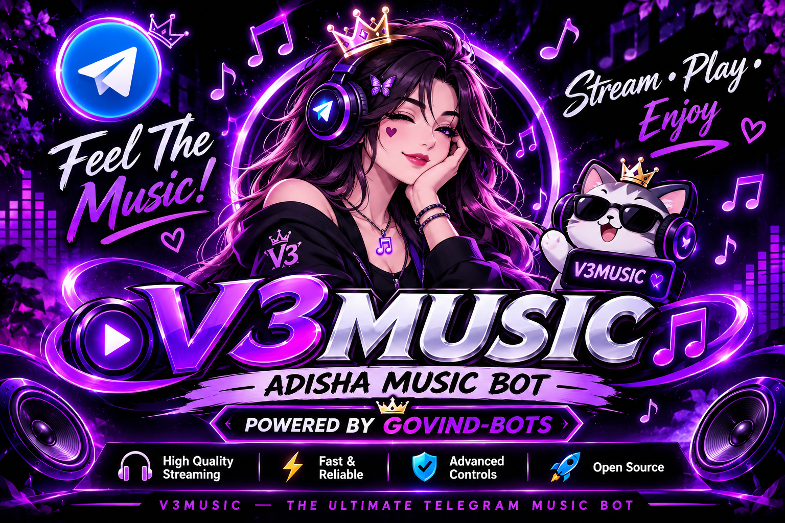
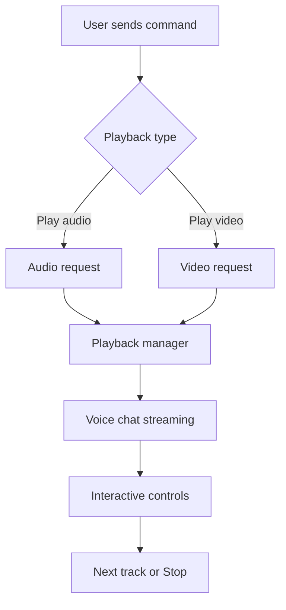

 

 

  

**A stylish Telegram Group Music Bot built for a better voice-chat experience.**

---

## ✦ WELCOME TO THE V3MUSIC UNIVERSE

> Not just another music bot. A complete music experience for your Telegram group.

V3MUSIC is a Telegram music bot designed to bring music playback and easy controls directly into your group's voice chat.

With a clean interface, interactive buttons, queue management and separate audio/video playback commands, V3MUSIC aims to make group music sessions simple and enjoyable.

---

## 🎧 THE MUSIC CONSOLE

| 🎵 AUDIO MODE | 🎬 VIDEO MODE | 🎛️ CONTROL DECK |
|:---:|:---:|:---:|
| Music playback | Video playback | Playback controls |
| `/play` | `/vplay` | Pause / Resume |
| Audio streaming | Video streaming | Skip / Stop |

---

## 📱 LIVE TELEGRAM MUSIC EXPERIENCE

  <b>V3MUSIC IN ACTION</b>
   
  A preview of the Telegram music playback interface

<table align="center" width="340">
<tr>
<td bgcolor="#17212B">

<table width="100%">
<tr>
<td align="left">
<b>5:35</b>
</td>
<td align="right">
● ● ● 4G ▰
</td>
</tr>
</table>

</td>
</tr>

<tr>
<td bgcolor="#17212B">

<table width="100%">
<tr>
<td width="12%" align="center">
❮
</td>
<td>
<b>ADISHA MUSIC GROUP</b>
 
Group · 128 members
</td>
<td align="right">
⋮
</td>
</tr>
</table>

</td>
</tr>

<tr>
<td bgcolor="#0E1621">

Today

<table align="right" width="85%">
<tr>
<td bgcolor="#2B5278">

<b>Govind</b>
  
/play Night Changes
 
5:35 PM ✓✓

</td>
</tr>
</table>

    

<table width="95%" align="left">
<tr>
<td bgcolor="#182533">

<b>🎧 V3MUSIC</b>

  

<b>▶ NOW PLAYING</b>

  

<table width="100%">
<tr>
<td width="42%" align="center" bgcolor="#273849">
 
🎵
 
ADISHA MUSIC
  
</td>
<td>
<b>Night Changes</b>
 
One Direction
  
Duration: 3:46
</td>
</tr>
</table>

 

1:24 ━━━━━●━━━━ 3:46

  

<table width="100%">
<tr>
<td align="center" bgcolor="#26394B">
⏸️
</td>
<td align="center" bgcolor="#26394B">
⏭️
</td>
<td align="center" bgcolor="#26394B">
⏹️
</td>
</tr>
<tr>
<td align="center">
Pause
</td>
<td align="center">
Skip
</td>
<td align="center">
Stop
</td>
</tr>
</table>

 

Requested by: Govind
 
Powered by GOVIND-BOTS

 

</td>
</tr>
</table>

  

Message · Voice Chat Music Streaming

</td>
</tr>
</table>

<b>🎵 V3MUSIC — Your Group, Your Music.</b>

---

<b>🎵 AUDIO EXPERIENCE</b>

 

- Play music in your Telegram group's voice chat.
- Use `/play` to request audio playback.
- Interactive playback controls.
- Queue-based music management.
- Track information and thumbnail support.

<b>🎬 VIDEO EXPERIENCE</b>

 

- Separate video playback command.
- Use `/vplay` for video requests.
- Dedicated video streaming mode.
- Designed for supported Telegram voice chats.

<b>🎛️ CONTROL EXPERIENCE</b>

 

- Pause current playback.
- Resume paused playback.
- Skip the current track.
- Stop playback.
- View the current music queue.
- Interactive buttons for supported actions.

---

## ✦ COMMAND CENTER

| COMMAND | DESCRIPTION |
|:---|:---|
| `/play` | Play audio in voice chat |
| `/vplay` | Start video playback |
| `/pause` | Pause current playback |
| `/resume` | Resume playback |
| `/skip` | Skip current track |
| `/stop` | Stop playback |
| `/queue` | Show music queue |

---

## ✦ HOW V3MUSIC WORKS

---

## ✦ FEATURE MATRIX

| FEATURE | DESCRIPTION |
|:---|:---|
| 🎵 Audio Playback | Play audio in voice chats |
| 🎬 Video Playback | Separate video playback command |
| 📋 Queue System | Manage requested tracks |
| ⏸️ Pause / Resume | Control playback |
| ⏭️ Skip System | Move to the next track |
| 🖼️ Thumbnails | Display track thumbnails where supported |
| 🎛️ Inline Buttons | Interactive playback interface |
| 🗄️ MongoDB | Database-backed features |
| ⚡ Pyrogram V2 | Telegram client framework |
| 🔊 PyTgCalls | Voice chat streaming |

---

## ✦ TECHNOLOGY STACK

  

---

## ✦ DEPLOYMENT

V3MUSIC can be configured for deployment on supported hosting platforms.

### Basic Setup

1. Fork this repository.
2. Configure the required environment variables.
3. Add your database configuration.
4. Install the project requirements.
5. Start the bot using the provided startup command.

**Important:** Check the repository configuration and README instructions before deployment. Required environment variables must be configured correctly.

---

## ✦ PROJECT LINKS

---

## ✦ DEVELOPER

**GOVIND**

*Creator & Developer of V3MUSIC*

[GitHub Profile](https://github.com/GOVIND-BOTS)

---

**✦ ADISHA MUSIC BOT ✦**

`POWERED BY GOVIND-BOTS`

*Made with Python and passion.*

